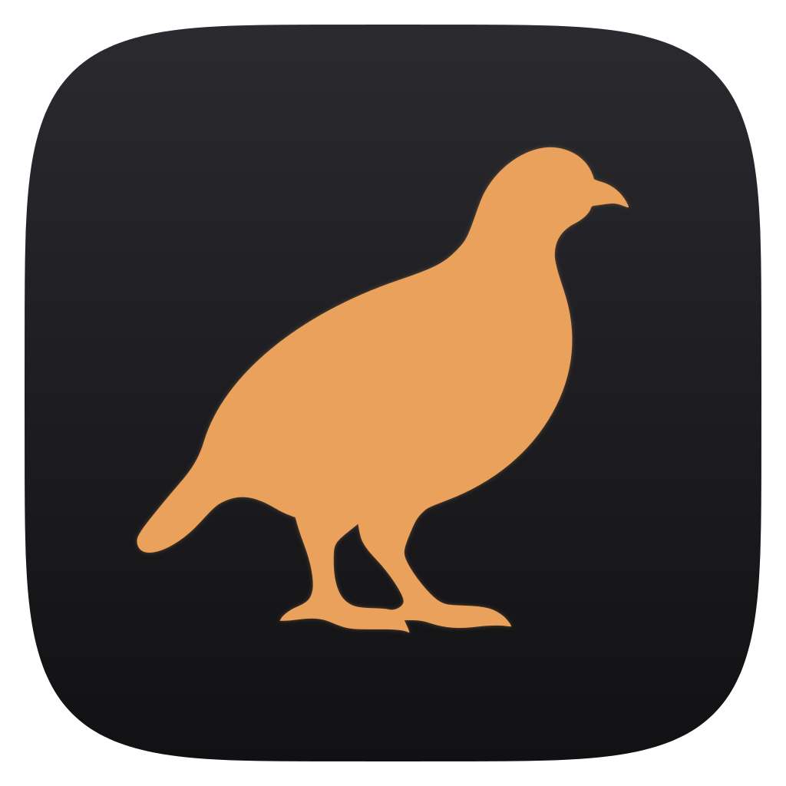
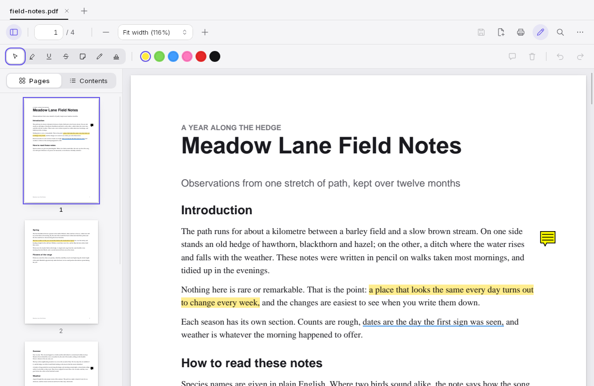

<div align="center">



# Patient Partridge

**A fast, small PDF reader and editor for Windows, macOS and Linux.**
Read PDFs, mark them up and fill in forms, without an account, a cloud, advertising or tracking.

[](https://github.com/Ferdinand99/Patient-Partridge/actions/workflows/ci.yml)
[](LICENSE)
[](https://hedgerow.tools/Patient-Partridge/)

<picture>
  <source media="(prefers-color-scheme: dark)" srcset="docs/screenshots/reader-dark.png">
  <source media="(prefers-color-scheme: light)" srcset="docs/screenshots/reader-light.png">
  
</picture>

</div>

> The screenshots are taken from a real Linux build (Xvfb) with a generated sample PDF.

Today Patient Partridge reads PDFs, marks them up with annotations, fills in their forms, makes new fillable forms, checks their digital signatures and works on their pages (the last three are new in 0.3, which is not released yet; the released 0.2.x reads, annotates and fills in forms). The other editing tools are planned and do not exist yet (see the [Roadmap](#roadmap)). Patient Partridge is part of the Hedgerow family of apps, next to [Nimble Newt](https://github.com/Ferdinand99/Nimble-Newt).

**Status: early release.** The latest version is on the [releases page](https://github.com/Ferdinand99/Patient-Partridge/releases/latest). Expect rough edges and missing features.

## Contents

- [Features](#features) · [Download](#download) · [Updates](#updates) · [Shortcuts](#keyboard-shortcuts)
- [Known limits](#known-limits) · [Security](#security) · [Building from source](#building-from-source)
- [Architecture](#architecture) · [Roadmap](#roadmap) · [Licence](#licence)

## Features

Every feature in detail is in [docs/features.md](docs/features.md).

- **Tabs.** Open one or more PDFs with Ctrl+O, by dropping them on the window, from the command line or with "Open with"; each file gets its own tab, and a file that is already open just shows its tab. [Details](docs/features.md#opening-files-and-tabs)
- **Continuous reading.** One scrolling view that draws only the pages you can see, so opening is quick and memory stays flat as documents get longer. Zoom, fit to the width, or jump to a page with Ctrl+G. [Details](docs/features.md#reading)
- **Side panel.** Page thumbnails and the table of contents (the bookmarks of the PDF) with Ctrl+B. [Details](docs/features.md#side-panel)
- **Text selection and copy.** Select with the mouse (double click for a word, triple click for a line, Ctrl+A for everything) and copy with Ctrl+C or the right mouse button. [Details](docs/features.md#selecting-and-copying-text)
- **Search.** Ctrl+F highlights the matches on the pages; case and line breaks are ignored, and you can stop a search at any time. [Details](docs/features.md#search)
- **Links that ask first.** A link in a PDF is never opened by itself: the whole address is shown and you are asked. Only http and https can be opened, in your browser, and attachments are never opened or even listed. [Details](docs/features.md#links-and-attachments)
- **Print.** Ctrl+P prints all pages, the page in view or a list such as 1-3, 7, 9-, as pictures at 150 dpi through your system's print dialog. Printing has not been tried on a real printer yet. [Details](docs/features.md#printing)
- **Remembers your place.** The page, position and zoom of the last 500 files, and the tabs you had open, come back at the next start. Both stay on your computer and can be switched off in the settings menu. [Details](docs/features.md#remembering-your-place-and-your-tabs)
- **Light and dark.** The look follows the system, or choose Auto, Light or Dark in the settings menu. The pages stay white, like paper. [Details](docs/features.md#look)
- **Passwords and damaged files.** Password-protected files ask for the password; a damaged file, or a file that is not a PDF, gives a clear message instead of a crash. [Details](docs/features.md#passwords-and-damaged-files)
- **Annotations.** Highlight, underline, strike out, notes, a pen and stamps, in six colours. They are real PDF annotations written by PDFium with appearance streams, so other readers can show and edit them. Annotations a file already has can be changed or removed, with some limits. [Details](docs/features.md#annotations)
- **Filling in forms.** Text fields, check boxes, radio buttons, drop-down lists and list boxes of a PDF form (AcroForm) are filled in and saved so that other readers show the result. [Details](docs/features.md#filling-in-forms)
- **Making forms.** The Edit form button opens a bar with Text, Check box, Radio, Drop-down, List and Signature tools and a panel for the picked field. Click or drag on a page to place a field, move and resize it, name it and set its properties; the fields are real form fields written into the file. Version 0.3. [Details](docs/features.md#making-forms)
- **Page tools.** Pick pages in the side panel and turn, delete, move, crop or copy them to a new file, add a blank page, or add all the pages of other PDF files (which is also how files are merged). Every change can be taken back with Ctrl+Z. Version 0.3. [Details](docs/features.md#page-tools)
- **A picture of a signature.** The Signature picture tool of the annotation bar puts a drawn, typed or imported picture of your signature on a page. **It is a picture, not a digital signature.** Version 0.3. [Details](docs/features.md#a-picture-of-a-signature)
- **Signing with a certificate.** The Sign with a certificate entry of the settings menu signs a copy of the open document with the key in a certificate file (.p12 or .pfx) and its password, which is not saved. RSA 2048 to 4096 and ECDSA P-256 and P-384; where the signature shows, and what it says, are your choice. The signing time is this computer's clock, no time stamp is added, and the document you had open is not changed. Version 0.3. [Details](docs/certificate-signing.md)
- **Digital signatures, read-only.** A signed document gets a badge and a panel that shows each signature as intact, changed or broken, with the certificate of the signer. The engine checks them in its sandbox. Version 0.3. [Details](docs/features.md#digital-signatures-read-only), [what is checked](docs/digital-signatures.md)
- **Safe saving.** Save and Save a copy write a new file next to the old one, have a second sandboxed engine check it, and only then replace the old file in one step. If anything goes wrong, the file on disk is exactly as it was. [Details](docs/features.md#saving)
- **Unsaved changes and undo.** A tab with unsaved changes shows a dot, and closing or quitting asks first. Undo and redo cover the last 200 changes of the open document. [Details](docs/features.md#unsaved-changes-and-undo)
- **Updates.** The app updates itself from GitHub Releases with a signature check; see [Updates](#updates).
- **A viewer in "Open with".** The installers register Patient Partridge as a viewer for PDF files. It does not take over as the default reader by itself. [Details](docs/features.md#pdf-viewer-registration)

## Download

Get the latest installer from the [Releases page](https://github.com/Ferdinand99/Patient-Partridge/releases/latest):

| Platform | File |
|---|---|
| Windows (x64) | `.exe` (setup) or `.msi` |
| macOS (Apple Silicon and Intel) | `.dmg` (universal) |
| Linux (x64) | `.AppImage` or `.deb` |

The macOS app is signed and notarised. The Windows build is not code-signed yet ([docs/signing.md](docs/signing.md)), so SmartScreen warns on first launch: click **More info**, then **Run anyway**. The look needs a recent web view; see [Known limits](#known-limits).

## Updates

Patient Partridge looks for a newer version when it starts and every 6 hours (a small pill appears in the toolbar), and **Check for Updates…** in the settings menu does it on request. The release notes are shown first; nothing is downloaded until you press Download and Install. The update is checked against the project's signing key before anything is installed, the PDF engines are stopped for the install, and the files you had open come back after the restart.

- The automatic check is on by default and can be turned off in the same menu.
- The Windows installer, the macOS app and the Linux AppImage update this way; a Linux deb package cannot, and shows a notice with a link to the releases page instead.
- An update is not installed while a document has unsaved changes; you can save and install in one step, or install later from the toolbar.
- How it works, what is sent and what has been tried: [docs/updates.md](docs/updates.md).

## Keyboard shortcuts

On macOS, `Cmd` takes the place of `Ctrl`. The annotation keys work with the document in front, not while typing.

| Keys | What they do |
| --- | --- |
| Ctrl+O, Ctrl+W, Ctrl+Tab, Ctrl+Shift+Tab | Open a file, close the tab, next tab, previous tab |
| Ctrl+S, Ctrl+Shift+S | Save, save a copy |
| Ctrl+Z, Ctrl+Y or Ctrl+Shift+Z | Undo, redo |
| Ctrl+F, F3, Shift+F3 | Find, next match, previous match |
| Ctrl+B, Ctrl+G, Ctrl+P, Ctrl+A | Side panel, go to a page, print, select all text |
| Ctrl+Plus, Ctrl+Minus, Ctrl+0, Ctrl+1 | Zoom in, zoom out, fit the width, 100 % |
| Arrow keys, Page Up, Page Down, Space, Home, End | Move through the document |
| Ctrl+Shift+A | Show or hide the annotation bar |
| Arrow keys, Shift, Alt, Delete, Enter, Esc (a picked field in Edit form) | Move a field by a point (ten with Shift), resize it with Alt, delete it, move to the panel, let go or go back to Select |
| V, H, U, T, N, P, M | Select, Highlight, Underline, Strike out, Note, Pen, Stamp (with the document in front, not while typing). M again opens the list of stamps |
| Enter (Note or Stamp tool) | Place the note or the stamp in the middle of what is shown |
| Tab, Enter, Delete, arrow keys (a picked annotation) | Pick an annotation, change its text, delete it, move a note by 4 points (24 with Shift) |
| Left and Right arrow, Home, End (in the annotation bar) | Move along the buttons; the bar is one stop in the Tab order |
| Ctrl+Enter (in the box for a note) | Save the text |
| Esc | Leave the box for a note, stop drawing, let go of an annotation, go back to Select |

The pen needs a pointer: there is no way to draw with the keyboard. The text to mark is selected with the mouse; the keyboard cannot select a stretch of text yet (Ctrl+A selects everything).

## Known limits

The full list, with the reasons, is in [docs/known-limits.md](docs/known-limits.md). The ones to know first:

- **Deleting an annotation is not redaction.** Saving after a delete leaves the text of the comment out of the new file, but nothing on the page itself is removed, and copies and backups made before the save still hold the text. Real redaction is planned. [Details](docs/known-limits.md#annotations)
- **The engine on Windows is not blocked from the network in 0.2.x.** The sandbox keeps files, windows, the clipboard, other processes and memory away from it, but an exploited engine could send out what it can read. On Linux and macOS the network is blocked. From 0.3 the engine on Windows runs in an AppContainer without network capabilities; the details, including what is known and what is only inferred, are in the security page. [Details](docs/security.md#what-it-does-not-cover)
- **Digital signatures.** A save always writes the whole document again, so saving a signed document breaks its signature. The app asks first (Cancel, Save a copy, Save anyway). Checking signatures is not there in 0.2.x; 0.3 reads and checks them but does not make them, and its trust list is empty, so no signature is shown as trusted. [Details](docs/known-limits.md#saving-and-digital-signatures), [what is checked](docs/digital-signatures.md)
- **A file that another program rewrites while it is open** loses every edit you made since you opened it: Save and Save a copy refuse, and you have to open the file again. [Details](docs/known-limits.md#a-file-that-changes-while-it-is-open)
- **Forms.** XFA forms are shown but not filled in, and PDF JavaScript never runs, so fields that are calculated by script do not update. [Details](docs/known-limits.md#forms)
- **Making forms (0.3).** Only documents the writer can read are changed (not encrypted ones, XFA forms or documents whose structure it does not understand), text a field draws must be in Latin-1, and only fields the designer made, with no action, can be changed by it. [Details](docs/known-limits.md#making-forms)
- **Signing with a certificate (0.3).** Documents that already hold signatures, encrypted documents and XFA forms are not signed; no time stamp is written; a signature made today shows as "signer not verified" here. [Details](docs/known-limits.md#signing-with-a-certificate)
- **A picture of a signature (0.3)** proves nothing about who placed it; after a save it is an ordinary stamp that can be removed but not moved. [Details](docs/known-limits.md#a-picture-of-a-signature)
- **Page tools (0.3).** Crop does not remove anything, a copy of pages carries no bookmarks, and pages added from a protected file lose its protection. [Details](docs/known-limits.md#page-tools)
- **Fonts a PDF does not embed.** Chinese, Japanese, Korean, Arabic, Hebrew and Thai text without embedded fonts needs a font from a fixed list of system files; otherwise it shows as blanks (it can still be searched and copied). [Details](docs/known-limits.md#fonts-that-a-pdf-does-not-embed)
- **Quitting.** Unsaved changes are lost without a question when macOS ends the app from the Dock menu, a log out, a restart or a shut down. Windows and Linux ask only when the window is closed; save before you log out, restart or shut down. [Details](docs/known-limits.md#quitting-with-unsaved-changes)
- **Memory.** About 490 MB for the whole app with a 500-page file open on Linux; the goal of 150 MB is not met there. Windows and macOS have not been measured on real hardware. [Details](docs/known-limits.md#memory)
- **Web view.** It must be recent: WebView2, WebKitGTK 2.46 or newer, and a macOS version whose web view is Safari 17.5 or newer. [Details](docs/known-limits.md#web-view)
- **Size.** A document is saved only if the saved file would be at most 512 MiB. [Details](docs/known-limits.md#saving-size-and-the-file-system)

## Security

<a id="security-what-is-protected-and-what-is-not"></a><a id="security-what-is-protected-and-what-is-not-yet"></a>

A PDF is untrusted input, and PDFium, the library that parses it, is the main attack surface. Please read [docs/security.md](docs/security.md) before you open files from people you do not trust.

- **One engine process per document.** Each open document is read by an engine process of its own, locked into an operating system sandbox before it reads the first byte: a seccomp filter on Linux (plus Landlock where the kernel has it), a Seatbelt profile on macOS, and a restricted token, a job object and a desktop of its own on Windows. A file that crashes or hangs its engine closes only its own tab.
- **No files, no programs.** The engine cannot open files, start programs or touch other processes. It reads the one document the app opens for it through a read-only handle, and it is started with an empty environment.
- **No network.** The engine has no network code (apart from the few attempts its own sandbox check makes on purpose, which must fail), and the sandbox stops any code in the process from reaching the network: it refuses to make a socket on Linux and macOS, and from 0.3 the engine on Windows runs in an AppContainer without network capabilities. **In 0.2.x the engine on Windows can use the network**; a restricted token alone does not stop it. [Details](docs/security.md#what-it-does-not-cover)
- **Memory limit.** The engine cannot use more than 3 GiB (a job object on Windows, a data limit on Linux, a watch by the app on macOS).
- **The engine checks itself.** A release build that cannot show a working sandbox does not open the document and tells you so.
- **PDF JavaScript is off.** The PDFium build has no JavaScript engine, and a form is checked for actions that could change it before you can fill it in; the check is a reading of the file, not a guarantee.
- **The signer holds the key in a process of its own.** The certificate file and its password go to `partridge-signer`, which is locked in like the engine, has no file and no network, signs a digest and never sees the document. [Details](docs/security.md#the-signer)
- **The app itself is not sandboxed.** The sandbox protects you from a bad PDF, not from a bug in the app, and no sandbox protects against a bug in the operating system kernel.
- **The only network use is the update check.** It runs at the start and every 6 hours, can be turned off, and never sends a document. A link in a PDF goes nowhere unless you say yes.

## Building from source

You need Rust (stable), Node.js 22 and, on Linux, the [Tauri system packages](https://tauri.app/start/prerequisites/).

```sh
npm ci
npm run prepare:dev     # downloads PDFium (checked) and builds the engine
npm run tauri dev
```

Tests:

```sh
npm test                          # TypeScript unit tests
cargo test --workspace --locked   # needs the PDFium download from prepare:dev
npm run build && npx playwright install chromium && npm run e2e   # the window in a real browser
```

Installers for testing (not signed, no update files): `npm run bundle`. How the tests are built, fuzzing, the Windows standard-user run, releases and measuring speed and memory are in [docs/development.md](docs/development.md).

## Architecture

```
crates/protocol       the message format between app and engine
crates/engine         partridge-engine, the only code that parses PDFs
crates/engine-client  starts the engine, talks to it, recovers when it crashes
crates/testkit        generates small test PDFs (also a broken one, a password-protected one, and signed ones with keys made in the tests)
src-tauri             the app process (Rust)
src                   the window (TypeScript)
scripts               PDFium download, bundling, measurements
```

The window is a [Tauri 2](https://tauri.app/) app written in TypeScript (Vite) with a small Rust core. PDF files are read by a separate program, `partridge-engine`, which uses [PDFium](https://pdfium.googlesource.com/pdfium/) (the PDF library of Chrome) through [pdfium-render](https://crates.io/crates/pdfium-render); the app starts it and talks to it over standard input and output with a small binary protocol. The engine writes nothing, also when a document is saved: it serialises the document into memory and the app writes the file. The PDFium library is downloaded from [bblanchon/pdfium-binaries](https://github.com/bblanchon/pdfium-binaries) at a pinned release and its SHA-256 checksum is checked before it is used. At most 16 documents are open at once. More in [docs/architecture.md](docs/architecture.md).

## Roadmap

Version 0.2.2 is out and 0.3 is in development. There are no dates for what comes next; each step is done when it works, and the order may change.

- **Released, 0.1.0:** the reader (tabs, search, selecting and copying text, thumbnails, the table of contents, printing, dark mode and remembering your place).
- **Released, 0.2.0:** annotations and filling in forms.
- **In development, 0.3:** creating fillable forms, a picture of a signature, checking digital signatures (read-only) and page tools (merging, reordering, cropping, rotating, extracting, copying out and deleting pages).
- **Planned:** signing a document with a digital signature.
- **Planned:** editing text and images on the page, and real redaction that removes the content from the file, not just covers it.
- **Planned:** compressing files, flattening documents, and converting to and from Word, Excel, PowerPoint and images, including images (JPG, PNG, HEIC), text and Office files into PDF, on your own computer.
- **Planned:** watermarks and page numbers, protecting a file with a password, and removing a password you already know.
- **Planned:** text recognition (OCR) for scanned documents, on your own computer.
- **Planned, for later:** an optional, on-device feature for summaries and questions on a Mac, using Apple's on-device model.

## Licence

Patient Partridge is free software under the [GNU Affero General Public License, version 3](LICENSE). PDFium is under a BSD-style licence; its licence files are shipped with the app.

The licence texts of the Rust crates and npm packages inside the app are in [THIRD-PARTY-NOTICES](THIRD-PARTY-NOTICES), which every installer ships next to the AGPL text. The file is made by `scripts/notices.sh` (cargo-about, pinned) and CI fails when it is out of date or when a dependency has a licence that is not on the allowlist in `about.toml`. After changing a dependency, run `npm ci && scripts/notices.sh` and commit the result.
